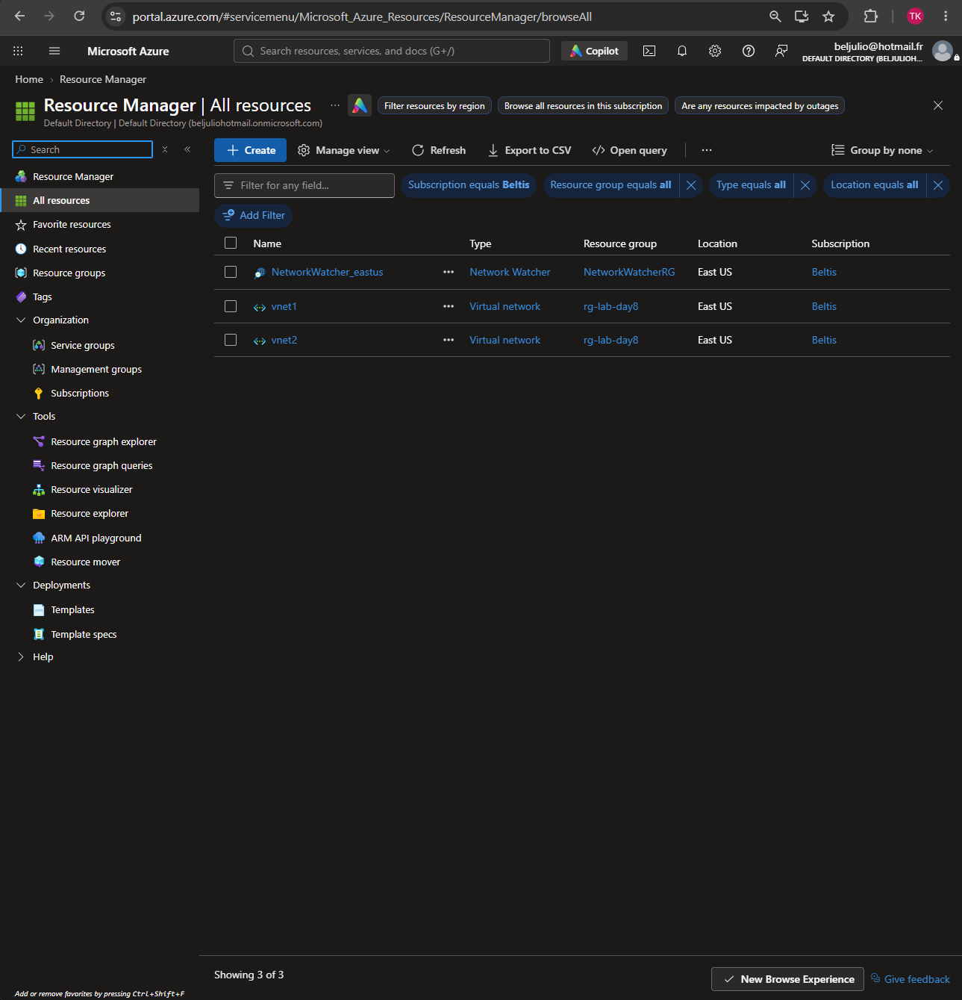
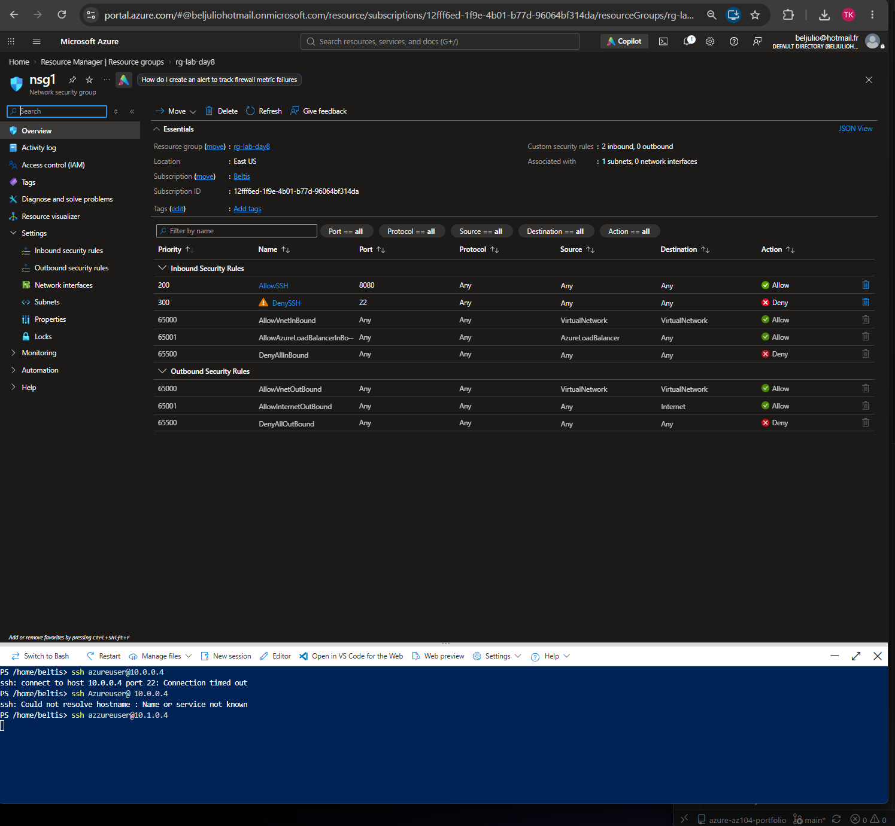
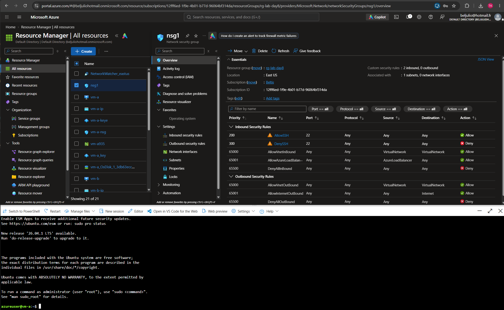

# Day 08 – Networking 1 (VNets, Subnets, NSGs)

**Exam domain: Networking** 
**Date completed:10/24/2026**

## What I built
Created	two	VNets	(vnet1	at	10.0.0.0/16,	vnet2	at	10.1.0.0/16),	each	with	one	subnet,	and deployed a	test	VM	into	each.	Attached an NSG	to vnet1/subnet1	and	ran	a	controlled priority	experiment:	added	a	DenySSH	rule	at	priority	100,	then	an	AllowSSH	rule	at priority	200	(SSH	still	blocked),	then	changed	DenySSH's	priority	to	300,	after	which	SSH succeeded.

## Key commands / concepts used
Portal	paths	used:	Network	security	group	>	Inbound	security	rules	>	+
Add	DenySSH:	port	22,	Deny,	priority	100	AllowSSH:	port	22,	Allow,
priority	200	(then	DenySSH	priority	changed	to	300)

## What I learned / what surprised me
NSG	rules	are	evaluated	strictly	by	priority	number,	lowest	number	first,	regardless	of the	order	the	rules	were	created	in	or	how	specific	they	are.	Running	the	before/after test	myself	made	this	concrete	instead	of	just	memorizing	it	for	the	exam
I learned that	NSG	rules	are	evaluated	by	priority	number,	not	by	order	or	specificity.

## Screenshots

