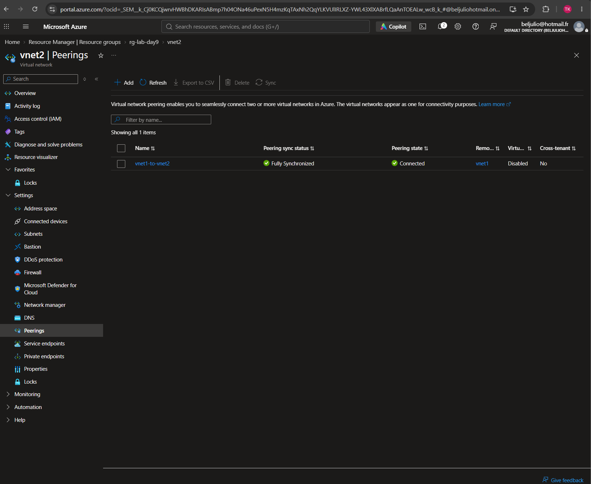
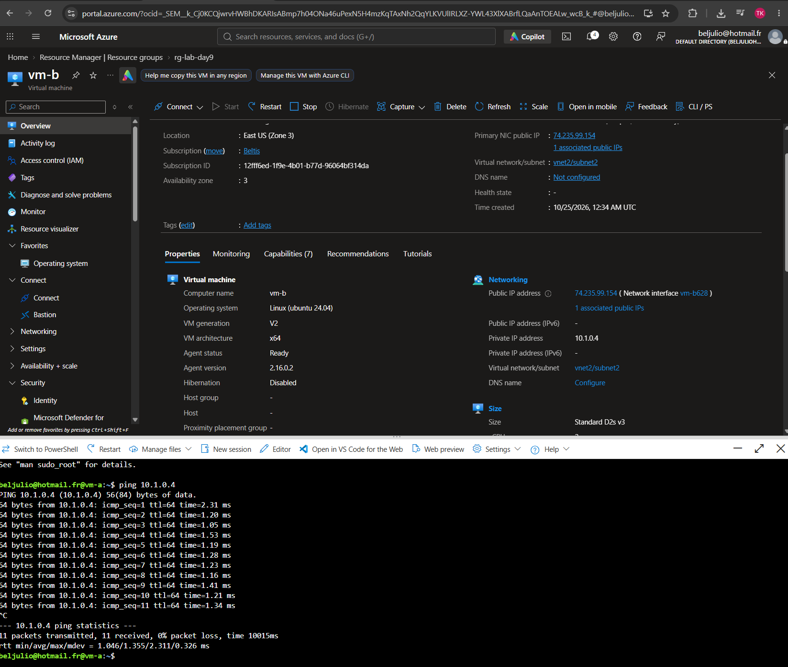
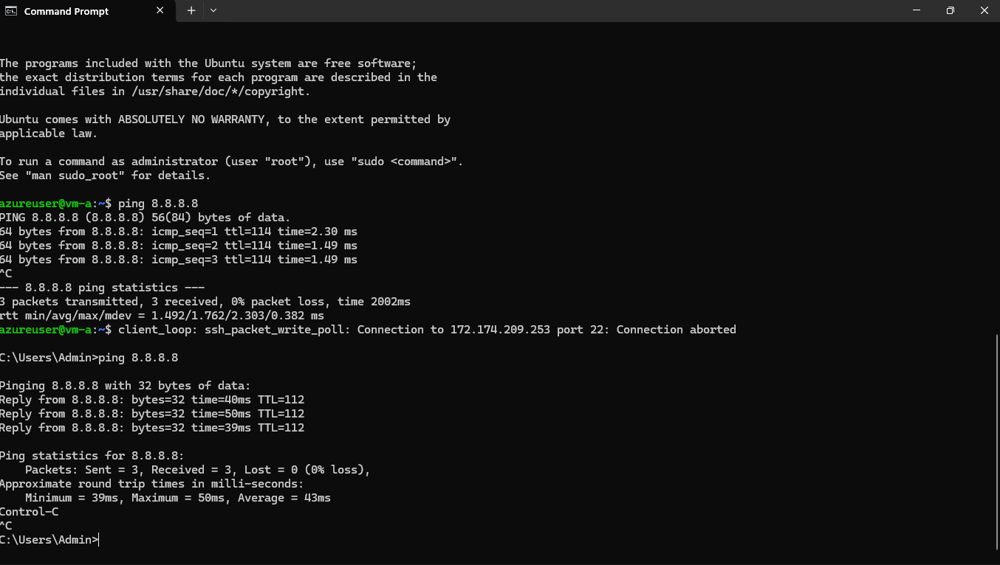

# Day 09 – Networking II (Peering, UDRs, DNS)

**Exam domain: Networking**  
**Date completed:10/24/2026**

## What I built
Rebuilt	the	two	VNets	from	Day	8	and	peered	them	together,	then	confirmed	connectivity	by
pinging	between	VMs	in	each	VNet	across	the	peering.	Created	a	User-Defined	Route	sending
all	outbound	traffic	(0.0.0.0/0)	to	next	hop	"None"	on	vnet1/subnet1	to	block	internet
access,	and	confirmed	pings	to	8.8.8.8	started	failing	afterward.	Set	up	a	private	DNS
zone	(lab.internal)	and	linked	it	to	vnet1.

## Key commands / concepts used
Portal	paths	used:	VNet	>	Peerings	>	+	Add	(vnet1-to-vnet2,	remote	=
vnet2)	ping	Route	table	(udr1)	>	Routes	>	+	Add	route	blockInternet:
prefix	0.0.0.0/0,	next	hop	type	None	associated	to	vnet1/subnet1	ping
8.8.8.8	Private	DNS	zone	(lab.internal)	>	Virtual	network	links

## What I learned / what surprised me
VNet	peering	gives	VMs	in	separate	VNets	private-IP	connectivity	without	any	gateway,	and
it's	non-transitive	by	default.	A	UDR	with	next	hop	"None"	acts	like	a	network-level	kill
switch	for	outbound	traffic	—	a	stronger	control	than	an	NSG	deny	rule,	since	it	operates
at	the	routing	layer	instead	of	the	packet-filtering	layer.

## Screenshots

