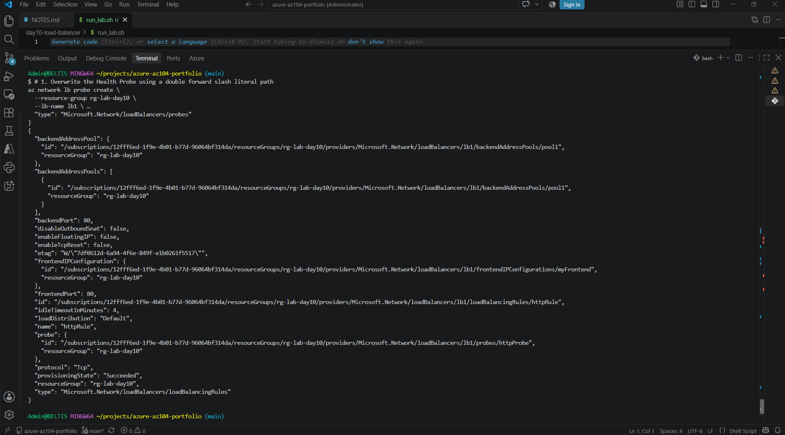
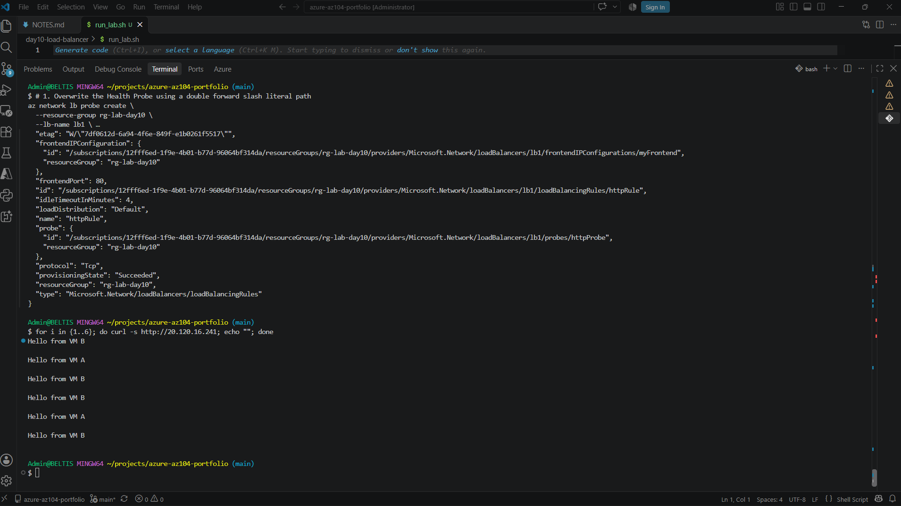

# Day 10 – Networking III (Load Balancer)

**Exam domain: Networking**  
**Date completed: 10/25/2026**

## What I built
Deployed	two	web	VMs	(vm-a,	vm-b),	each	running	nginx	with	a	distinct	homepage,	then
created	a	Basic	public	Load	Balancer	in	front	of	them	with	a	backend	pool,	an	HTTP	health
probe,	and	a	load-balancing	rule.	Verified	round-robin	traffic	distribution	by	repeatedly
browsing	the	load	balancer's	public	IP	and	watching	the	response	alternate	between	the
two	VMs'	homepages.	Also	reviewed	(without	deploying)	VPN	Gateway	and	Application	Gateway
via	a	Microsoft	Learn	module.

## Key commands / concepts used
sudo	apt	update	&&	sudo	apt	install	-y	nginx	echo	"Hello	from	VM	A"	|sudo	tee	/var/www/html/index.html
sudo	apt	update	&&	sudo	apt	install	-y	nginx	echo	"Hello	from	VM	B"	|sudo	tee	/var/www/html/index.html

## What I learned / what surprised me
A	Basic	Load	Balancer	operates	at	Layer	4	(TCP/UDP)	and	just	needs	a	healthy	backend	pool
plus	a	probe	to	start	distributing	traffic	—	it	doesn't	inspect	HTTP	content	the	way
Application	Gateway	(Layer	7,	with	WAF)	does.	I	deliberately	did	not	deploy	VPN	Gateway	or
Application	Gateway	myself,	since	both	bill	hourly	even	when	idle.

**CLI commands ran**
# 1. Create a Frontend Public IP using the Standard SKU
az network public-ip create \
  --resource-group rg-lab-day10 \
  --name lb-pip \
  --sku Standard

# 2. Instantiate a Standard SKU Load Balancer
az network lb create \
  --resource-group rg-lab-day10 \
  --name lb1 \
  --sku Standard \
  --public-ip-address lb-pip \
  --frontend-ip-name myFrontend \
  --backend-pool-name pool1

# 3. Add VM-A into the backend pool
az network lb address-pool address add \
  --resource-group rg-lab-day10 \
  --lb-name lb1 \
  --pool-name pool1 \
  --name vm-a-addr \
  --vnet vnet1 \
  --ip-address 10.0.1.4

# 4. Add VM-B into the backend pool
az network lb address-pool address add \
  --resource-group rg-lab-day10 \
  --lb-name lb1 \
  --pool-name pool1 \
  --name vm-b-addr \
  --vnet vnet1 \
  --ip-address 10.0.1.5

# 5. Create the Health Probe on Port 80
az network lb probe create \
  --resource-group rg-lab-day10 \
  --lb-name lb1 \
  --name httpProbe \
  --protocol Http \
  --port 80 \
  --path //

# 6. Generate the active Load Balancing rule
az network lb rule create \
  --resource-group rg-lab-day10 \
  --lb-name lb1 \
  --name httpRule \
  --protocol Tcp \
  --frontend-port 80 \
  --backend-port 80 \
  --frontend-ip-name myFrontend \
  --backend-pool-name pool1 \
  --probe-name httpProbe

## Screenshots

