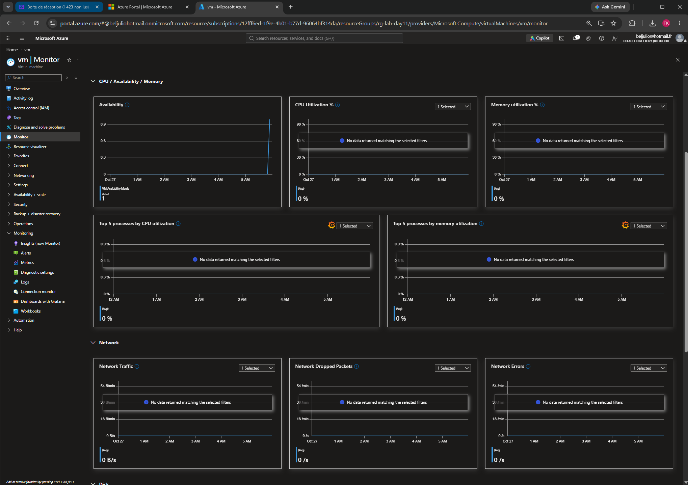

# Day 11 – Monitoring I (Azure Monitor, Alerts)

**Exam domain: MONITORING** 
**Date completed:10/27/2026**

## What I built
Deployed	a	VM	and	connected	it	to	a	new	Log	Analytics	workspace	(lawlab11)	via	VM
Insights	to	get	live	CPU,	memory,	and	disk	metrics.	Created	a	metric	alert	rule
(high-cpu-alert)	on	Percentage	CPU	with	a	low	threshold,	backed	by	a	new	action	group
(ag-lab11)	tied	to	my	email,	and	confirmed	I	received	the	alert	email	within	about	10
minutes.	Also	explored	the	Activity	Log	and	Metrics	Explorer	for	the	same	VM.

## Key commands / concepts used
Portal	paths	used:	VM	>	Insights	>	Enable	(workspace:	lawlab11)	VM	>
Alerts	>	+	Create	>	Alert	rule	condition:	Percentage	CPU,	threshold	1,	5
min	granularity	action	group:	ag-lab11	(email)	Monitor	>	Activity	log
Monitor	>	Metrics

## What I learned / what surprised me
Azure	Monitor	alert	rules	need	three	parts	working	together	—	a	signal/condition,	an
action	group,	and	a	rule	name/severity	—	and	action	groups	are	reusable	across	multiple
alert	rules,	so	they're	worth	naming	and	organizing	thoughtfully	instead	of	creating	a
new	one-off	group	per	alert.

## Screenshots

